<h1 align="center">
  🌌 Omarchy Linux Dotfiles
  <br>
  
</h1>

<p align="center">
  <i>Воспроизводимые конфиги для Arch Linux + <a href="https://omarchy.org">Omarchy</a> (Hyprland) в своей теме <b>Rose Pine Hacker24</b>. macOS — вторичная платформа.</i>
</p>

> **🇬🇧 In English.** Arch Linux + [Omarchy](https://omarchy.org) (Hyprland) dotfiles in a custom
> **Rose Pine Hacker24** theme. Beyond the usual configs it reworks the Omarchy shell itself with
> Quickshell plugins: a top bar with 18 skins and a compact mode that expands on hover, an app launcher
> with 35 skins (star map, terminal, orrery, aquarium…), a lock screen with 21 designs, wallpaper
> transitions on a custom shader (24 effects), and a **Customizer** overlay (`Super+Shift+T`) that
> live-previews all of it. Every TUI app — Neovim, Yazi, lazygit, btop, tmux, Kitty — follows the active
> theme. Shell is Nushell + Starship; symlinks are managed by Dotbot, commands live in a `justfile`.
> **Full English README: [README.en.md](README.en.md).**

<p align="center">
  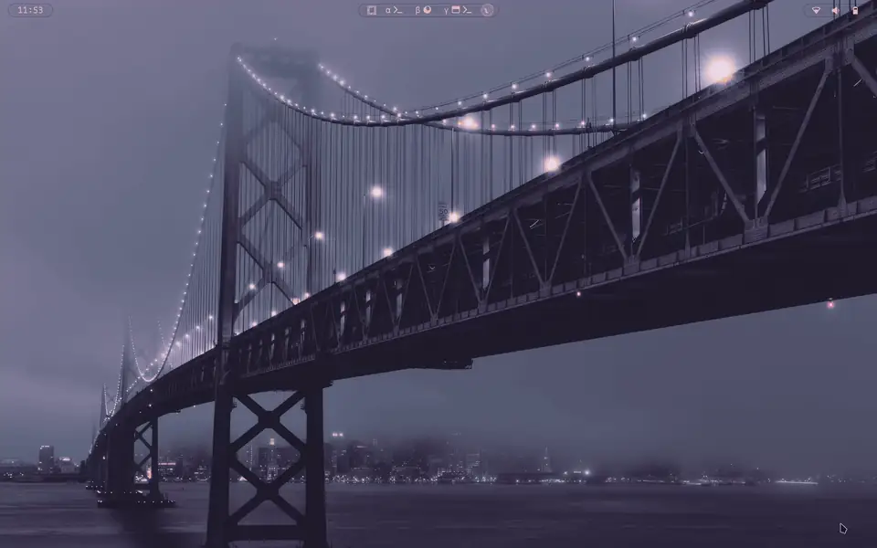
  <br>
  <sub>🎬 Полное видео со звуком (89 с, 🎵 Lane 8 — Little by Little): тайлинг, compact-бар, workspace, обзор скинов лаунчера, Customizer — <a href="assets/demo.mp4">assets/demo.mp4</a></sub>
</p>

<!-- Видео играет прямо в README, если ссылка user-attachments стоит отдельной строкой без <>.
     rumdl (MD034) иначе оборачивает её в <> — отсюда комментарий ниже.
     После обновления assets/demo.mp4 перетащи его в редактор README на GitHub и замени ссылку. -->
<!-- rumdl-disable-next-line MD034 -->
https://github.com/user-attachments/assets/b3709295-4c80-41c3-9966-e235e3b9c6af

---

## 📸 Галерея

| Рабочий стол (Hyprland + свой бар) | Терминал (Kitty + Nushell + fastfetch) |
| :---: | :---: |
| 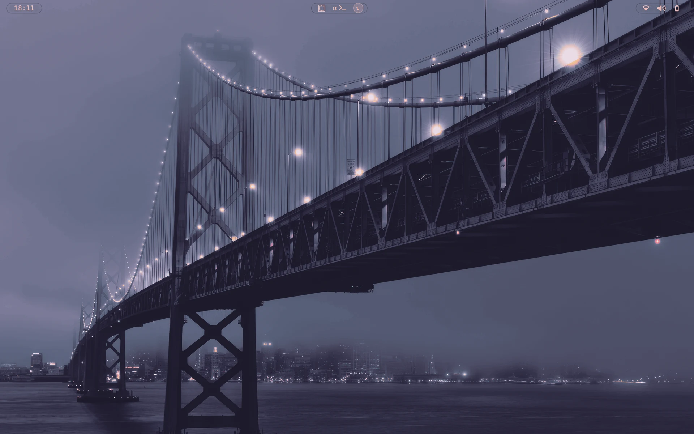 | 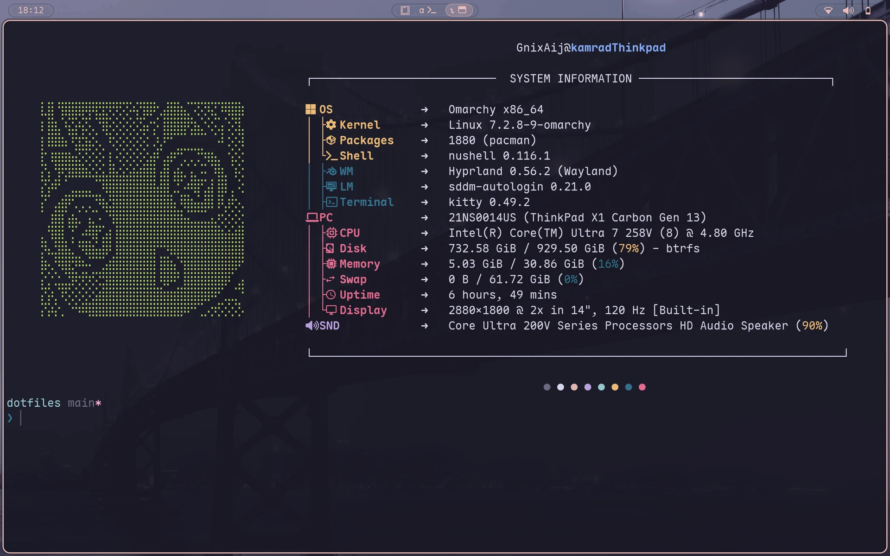 |
| **Neovim** | **Yazi** |
| 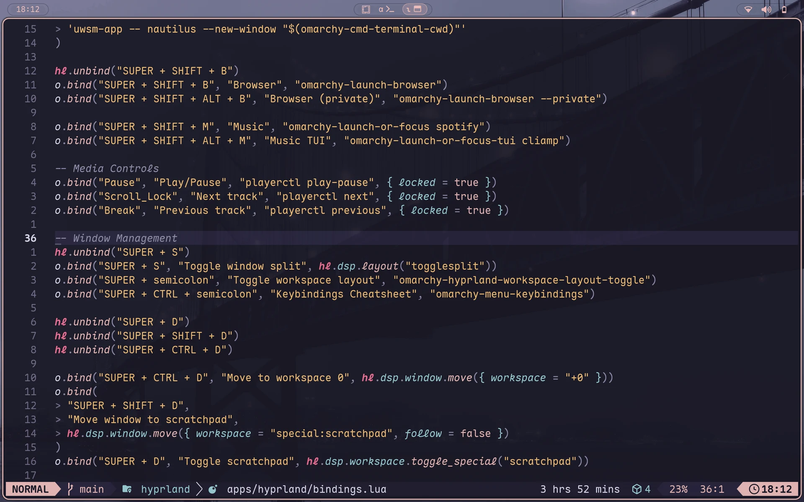 | 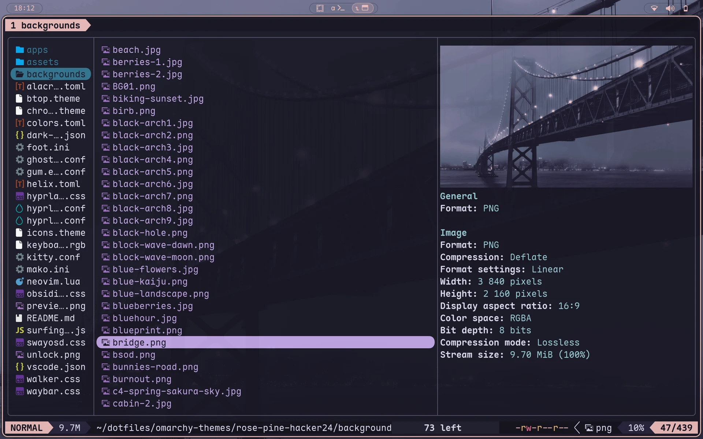 |
| **Customizer** (Super+Shift+T) | **Лаунчер** (скин terminal, Super+Alt+Space) |
| 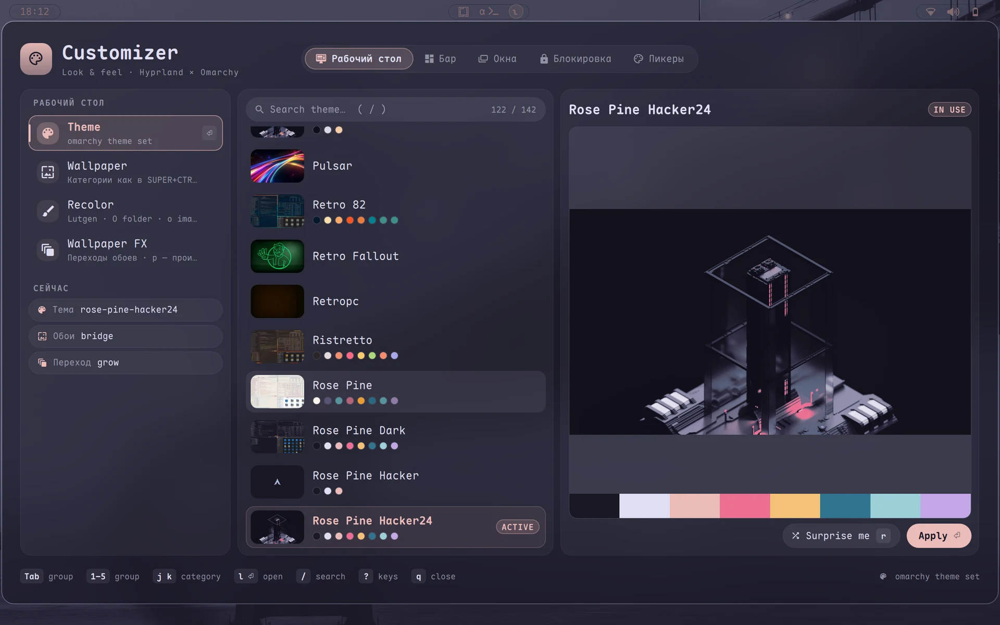 | 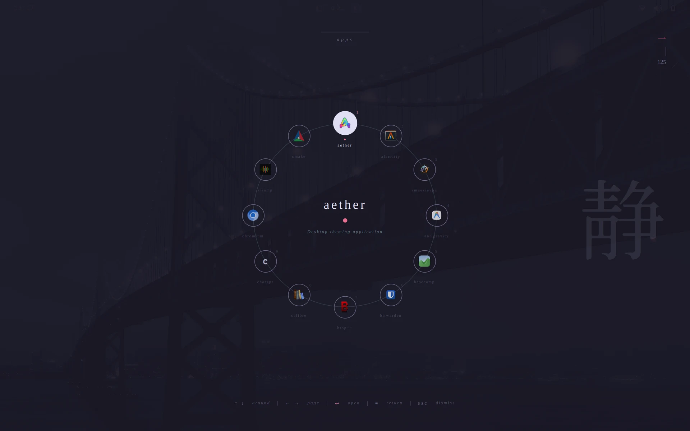 |
| **Музыка** (Spotifast + cava) | **Браузер** (Firefox, тема через Dark Reader / Stylus) |
| 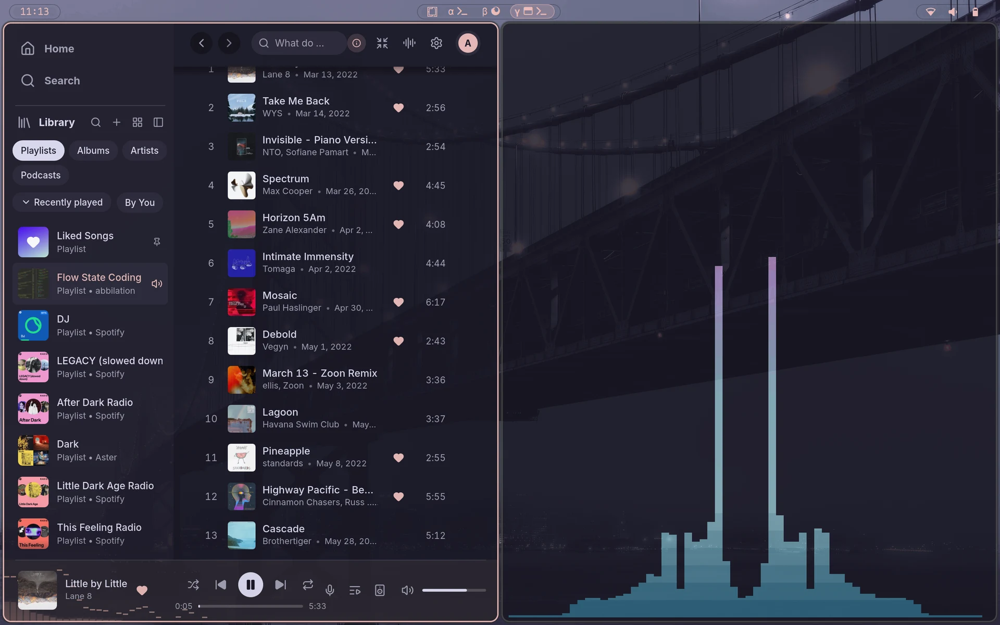 | 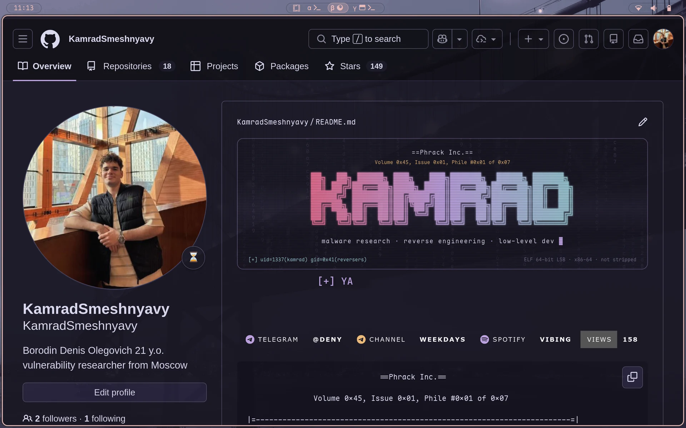 |

---

## 🧩 Плагины Omarchy отдельно

Каждый плагин оболочки — отдельный репо, ставится без остальных dotfiles через
`omarchy plugin add <url> --enable`:

| Плагин | |
| :--- | :--- |
| [omarchy-bar-skins](https://github.com/KamradSmeshnyavy/omarchy-bar-skins) | бар: 18 скинов, 9 раскладок, compact-режим с раскрытием по наведению, workspaces с 20+ стилями подписей |
| [omarchy-launcher-skins](https://github.com/KamradSmeshnyavy/omarchy-launcher-skins) | полноэкранные скины лаунчера: карта звёзд, CRT-терминал, планетарий, аквариум, таро, метро… |
| [omarchy-lock-designs](https://github.com/KamradSmeshnyavy/omarchy-lock-designs) | 21 дизайн экрана блокировки поверх стокового PAM, с безопасным фолбэком |
| [omarchy-wallpaper-fx](https://github.com/KamradSmeshnyavy/omarchy-wallpaper-fx) | 24 перехода обоев на одном своём шейдере |
| [omarchy-image-picker-styles](https://github.com/KamradSmeshnyavy/omarchy-image-picker-styles) | шесть стилей пикера тем и обоев |

**Customizer** (`Super+Shift+T`) есть только здесь: он управляет всеми плагинами, а также анимациями,
прозрачностью, блюром и шейдерами Hyprland.

---

## 🚀 Основные компоненты

| Категория | Что используется |
| :--- | :--- |
| 🪟 **WM** | **Hyprland** с конфигом на Lua (`apps/hyprland/`), изменения применяются через `hyprctl eval`. На macOS — yabai / AeroSpace / skhd / SketchyBar. |
| 🧩 **Оболочка Omarchy** | Свои плагины omarchy-shell (`apps/omarchy-shell/plugins/`): **бар** со скинами и compact-режимом ([docs](docs/apps/omarchy-shell-bar.md)), **экран блокировки** с 21 дизайном ([docs](docs/apps/omarchy-shell-lock.md)), **переходы обоев** — 24 эффекта на своём шейдере и стили пикеров ([docs](docs/apps/omarchy-shell-wallpaper.md)), **меню-лаунчер** со скинами (созвездие, CRT-терминал, zen и др.), **Customizer** — оверлей для темы, обоев, бара, окон, блокировки и пикеров. |
| 🎨 **Темы** | Свои темы Omarchy в `omarchy-themes/` (Rose Pine Hacker24, Pastel Hacker, Catppuccin Mocha, Nord, …). TUI-приложения следуют теме через слоты ([APP-THEMING](omarchy-themes/APP-THEMING.md)), браузеры — через Dark Reader и Stylus ([BROWSER-THEMING](omarchy-themes/BROWSER-THEMING.md)). |
| 🖥️ **Терминалы** | **Kitty** (основной), Ghostty (шейдеры и курсоры — сабмодули), WezTerm. |
| 🐚 **Оболочки** | **Nushell** (основной), Zsh, Fish; промпт — **Starship**. |
| 📝 **Редакторы** | **Neovim** (Lua), Helix, **VS Code** со своим CSS. |
| 🗃️ **Мультиплексоры** | **tmux**, Zellij. |
| 🛠️ **CLI / TUI** | yazi, lazygit / gitui / delta, bat, eza / lla, btop / procs, fzf / television, zoxide, atuin, glow, rmpc / cava, fastfetch. |
| ⌨️ **Ввод** | kanata, mouseless, wl-kbptr; на macOS — Karabiner и Hammerspoon. |

---

## 🧰 Утилиты

Все TUI-инструменты подхватывают цвета текущей темы Omarchy через слоты (`just app-themes`).

| Delta | LazyGit |
| :---: | :---: |
| [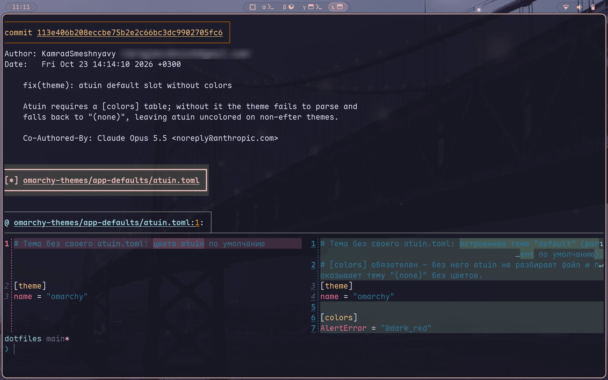](assets/delta.webp) | [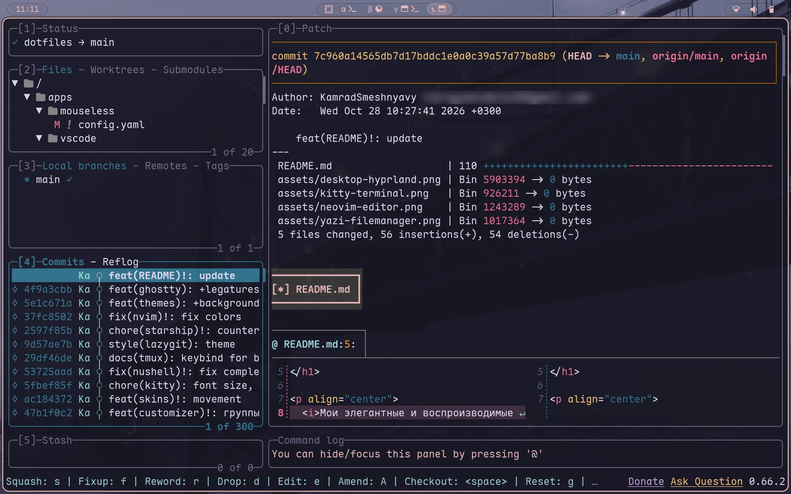](assets/lazygit.webp) |
| **eza & lla** | **bat** |
| [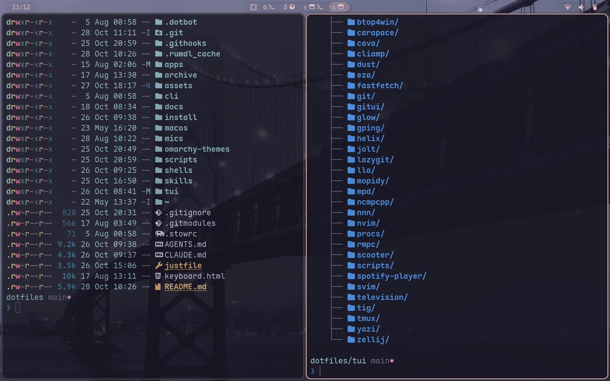](assets/eza_lla.webp) | [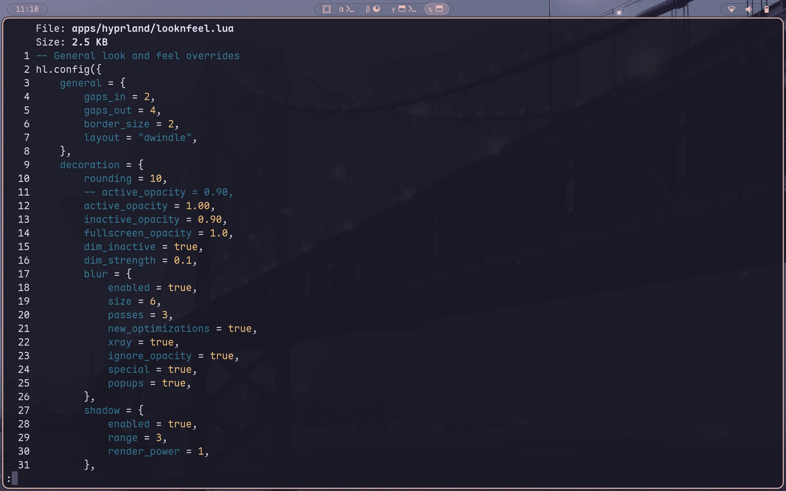](assets/bat.webp) |
| **tmux** | **fzf** |
| [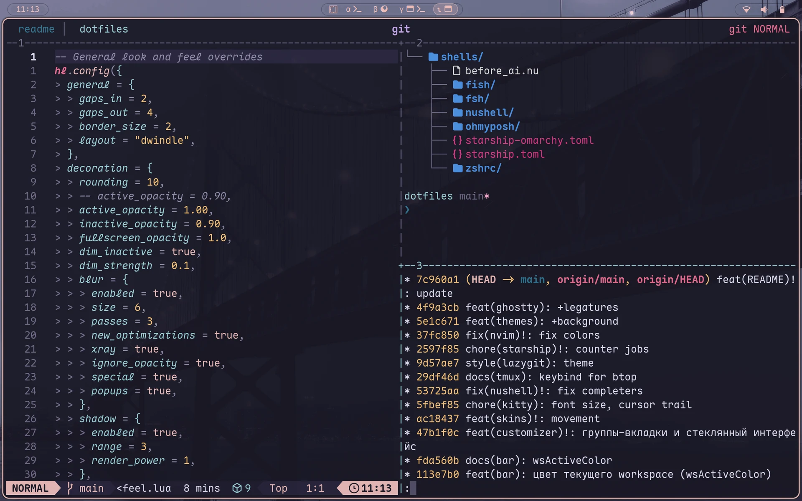](assets/tmux.webp) | [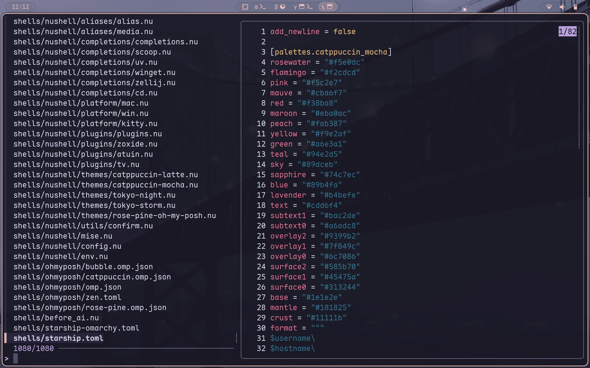](assets/fzf.webp) |
| **btop** | **procs** |
| [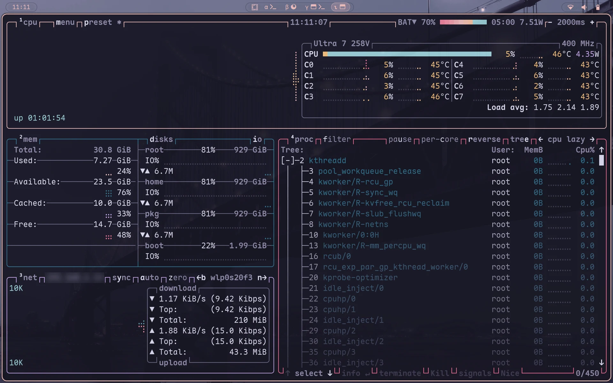](assets/btop.webp) | [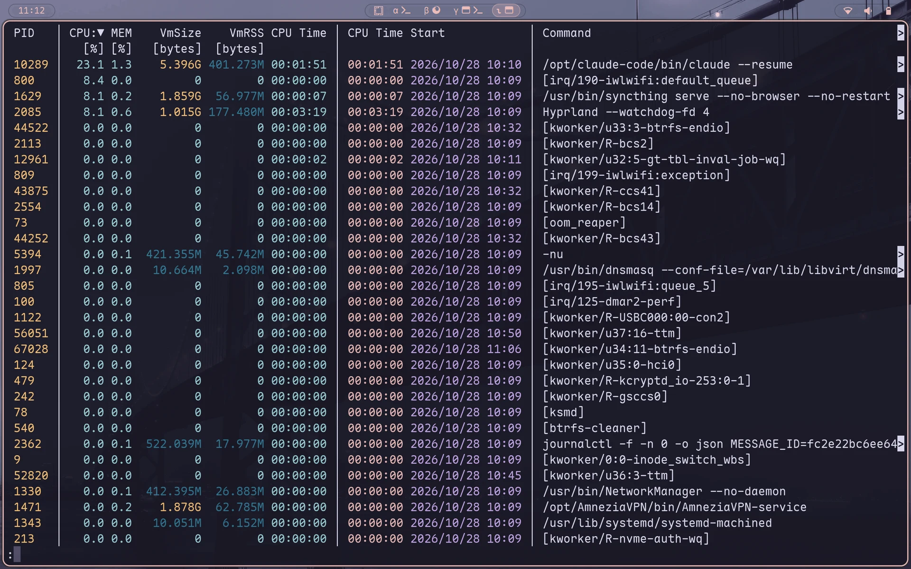](assets/procs.webp) |
| **Television** | **Scooter** |
| [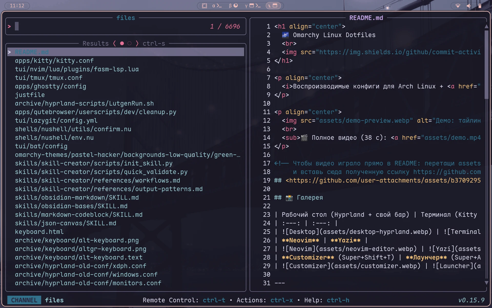](assets/television.webp) | [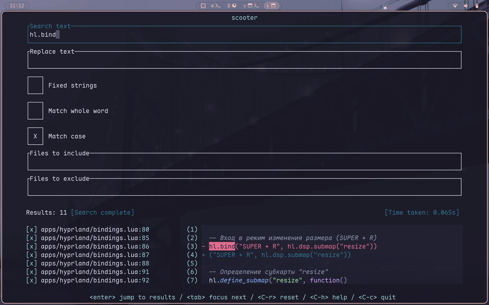](assets/scooter.webp) |

---

## 🛠️ Установка

```sh
# 1. Клонировать вместе с сабмодулями
git clone --recursive https://github.com/KamradSmeshnyavy/dotfiles.git ~/dotfiles
cd ~/dotfiles

# 2. Пакеты + симлинки (интерактивное меню: только пакеты / только dotfiles / всё)
./install/bootstrap.sh

# Только симлинки (Dotbot) + git hooks + AI-скиллы, если пакеты уже стоят
just link
just check-links      # ручные симлинки, которых нет в install/install.conf.yaml
just app-themes       # направить слоты тем приложений на текущую тему
```

Предпросмотр без изменений: `python3 install/install.py --dry-run`. Все команды — `just` без аргументов.

Нужны `git`, `python3`, `just`, `base-devel` и Nerd Font (везде используется **Maple Mono NF CN**).

---

## 📁 Структура

```text
dotfiles/
├── justfile           # все команды (рецепты разделены на Linux / macOS)
├── install/           # bootstrap.sh, install.py, install.conf.yaml (Dotbot), packages/
├── apps/              # GUI и окружение: hyprland, omarchy-shell, kitty, ghostty, vscode, …
├── tui/               # терминальные инструменты: nvim, helix, git, lazygit, yazi, tmux, …
├── shells/            # nushell, zshrc, fish, starship.toml
├── cli/               # ssh, p10k, todo
├── omarchy-themes/    # темы Omarchy, хуки и скрипты синхронизации тем
├── scripts/           # bin/ → ~/.local/bin, check-links, install-skill.nu
├── skills/            # AI-скиллы для агентов
├── macos/             # nix-darwin flake
├── docs/              # описание каждого конфига: docs/{apps,tui,shells,cli}/<имя>.md
└── assets/            # скриншоты и демо
```

Подробности для AI-агентов (Claude Code, Codex и др.) — в [AGENTS.md](AGENTS.md).
